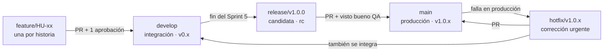

# Plan de Gestión de Configuración – Frutis ERP

Versión 1.0 · 28 de octubre de 2026 · Elemento de configuración EC-07

## 1. Introducción

Este plan define cómo se identifican, versionan, cambian y auditan los productos de trabajo de Frutis ERP + POS, desde el análisis hasta la línea base final del 25 de diciembre de 2026. Cumple la actividad CMMI-09 del plan de trabajo (área de proceso CM – Gestión de configuración).

**Alcance.** Aplica a la documentación del proyecto, el código de las tres capas, los scripts de base de datos, los prototipos de interfaz, el ejecutable y la configuración del servidor local.

**Referencias.**

- Cotización ERP Frutis v2.0 (27 de octubre de 2026).
- Análisis Preliminar (APR), Product Backlog y registro de riesgos.
- Plan de trabajo CMMI v2 y Documento de Arquitectura.
- Repositorio [edluj/frutis](https://github.com/edluj/frutis).

**Roles.**

| Rol | Quién | Responsabilidad |
| --- | --- | --- |
| Gestor de configuración | Arquitecto de Software | Mantener el repositorio, las reglas de ramas, las etiquetas de versión y las líneas base |
| Comité de control de cambios (CCB) | Líder de proyecto (preside), Arquitecto de Software y responsable del cliente | Aprobar o rechazar solicitudes de cambio que afecten alcance, tiempo o costo |
| Desarrolladores | Desarrolladores Desktop 1 y 2, Diseñador UX/UI | Trabajar en ramas, abrir Pull Requests y revisar el código de otros |
| Auditor de configuración | Especialista de QA | Verificar que cada línea base esté completa y sea consistente |

## 2. Elementos de configuración

Todo elemento de configuración (EC) tiene un identificador, vive en un solo lugar y entra a una línea base; lo que no está en esta tabla no se controla.

| ID | Elemento | Tipo | Ubicación | Responsable | Línea base |
| --- | --- | --- | --- | --- | --- |
| EC-01 | Cotización (propuesta técnica y económica) | Documento | `docs/gestion/` | Líder de proyecto | LB-1 |
| EC-02 | Análisis Preliminar (APR) | Documento | `docs/requisitos/` | Líder de proyecto | LB-1 |
| EC-03 | Product Backlog y registro de riesgos | Hoja de cálculo | `docs/gestion/` | Líder de proyecto | LB-1 |
| EC-04 | Plan de trabajo CMMI | Hoja de cálculo | `docs/gestion/` | Líder de proyecto | LB-1 |
| EC-05 | Documento de Arquitectura | Documento | `docs/arquitectura/` | Arquitecto | LB-2 |
| EC-06 | Prototipos de las 32 pantallas | Diseño (Figma) | Enlace en `docs/diseno/` | Diseñador UX/UI | LB-2 |
| EC-07 | Este plan de gestión de configuración | Documento | `docs/gestion/` | Arquitecto | LB-1 |
| EC-08 | Esquema de base de datos, Stored Procedure y Función escalar | Código SQL | `database/` | Desarrollador 1 | LB-3 |
| EC-09 | Middleware (API FastAPI) | Código Python | `middleware/` | Desarrollador 1 | LB-3 |
| EC-10 | Controladores de báscula e impresora | Código Python | `middleware/app/hardware/` | Desarrollador 2 | LB-3 |
| EC-11 | Aplicación de escritorio (PySide6) | Código Python | `frontend/` | Desarrollador 2 | LB-3 |
| EC-12 | Dependencias con versión fija | `requirements.txt` | `frontend/` y `middleware/` | Arquitecto | LB-3 |
| EC-13 | Matriz y evidencias de pruebas | Documento | `docs/pruebas/` | Especialista de QA | LB-4 |
| EC-14 | Ejecutable (.exe y binario Linux) | Binario | GitHub Releases | Desarrollador 2 | LB-5 |
| EC-15 | Configuración del servidor local (plantilla sin secretos) | Archivo `.env.example` | `deploy/` | Arquitecto | LB-5 |
| EC-16 | Manual de uso y documentación técnica | Documento | `docs/entrega/` | Arquitecto | LB-5 |
| EC-17 | Solicitudes de cambio y bitácora de apoyo | Registro | GitHub Issues (etiqueta `cambio`) | Líder de proyecto | LB-6 |

**Lo que nunca entra al repositorio:** contraseñas, `usuarios.txt`, certificados y llaves (`server.key`, `server.crt`), certificados de sello digital (CSD), respaldos de la base de datos y datos reales de ventas. Se protegen con `.gitignore` y se entregan al cliente por un canal aparte.

## 3. Estructura del repositorio

Un solo repositorio, `edluj/frutis` en GitHub, guarda las tres capas y la documentación; el código anterior (prototipo Tkinter con archivos .txt) está en `legacy/` como referencia y no se despliega.

```
frutis/
├── frontend/            # EC-11 · App PySide6
├── middleware/          # EC-09, EC-10 · API FastAPI y controladores
├── database/            # EC-08 · schema.sql, procedures/, functions/, seed.sql
├── deploy/              # EC-15 · .env.example, instalación del servidor
├── docs/
│   ├── gestion/         # EC-01, 03, 04, 07
│   ├── requisitos/      # EC-02
│   ├── arquitectura/    # EC-05
│   ├── diseno/          # EC-06 (enlace a Figma)
│   ├── pruebas/         # EC-13
│   └── entrega/         # EC-16
├── legacy/              # Prototipo anterior, solo referencia
├── .github/
│   ├── pull_request_template.md
│   └── ISSUE_TEMPLATE/solicitud_de_cambio.md
├── .gitignore
├── CHANGELOG.md
└── README.md
```

## 4. Estrategia de ramas

Se usa un flujo Git Flow simplificado: `main` siempre contiene lo que corre en la frutería y `develop` lo que se integra en cada sprint.



Cada historia del backlog vive en su propia rama `feature/` y entra a `develop` por Pull Request revisado. Al cerrar el Sprint 5 se abre `release/v1.0.0` para pruebas integrales y, aprobada por QA, pasa a `main`. Una falla en producción se corrige en `hotfix/`, que vuelve a `main` y también a `develop` para no perder la corrección.

## 5. Convenciones

Cada cambio de código se rastrea de la historia del backlog al commit y al Pull Request por el identificador HU-xx.

**Nombres de ramas.**

| Tipo | Formato | Ejemplo |
| --- | --- | --- |
| Historia de usuario | `feature/HU-<número>-<nombre-corto>` | `feature/HU-07-lectura-bascula` |
| Corrección en desarrollo | `fix/<número de issue>-<nombre-corto>` | `fix/23-redondeo-cambio` |
| Versión candidata | `release/v<versión>` | `release/v1.0.0` |
| Corrección urgente en producción | `hotfix/v<versión>-<nombre-corto>` | `hotfix/v1.0.1-ticket-duplicado` |
| Documentación | `docs/<nombre-corto>` | `docs/plan-configuracion` |

**Mensajes de commit** (formato Conventional Commits, en español):

```
<tipo>(<módulo>): <qué cambia en presente> [HU-xx]

feat(pos): calcula importe por peso desde la báscula [HU-07]
fix(middleware): rechaza token expirado con 401 [HU-05]
docs(arquitectura): agrega flujo del cobro
```

Tipos: `feat`, `fix`, `docs`, `test`, `refactor`, `chore`. Módulos: `pos`, `compras`, `facturacion`, `finanzas`, `inventario`, `admin`, `reportes`, `middleware`, `db`, `hardware`.

**Pull Requests.**

- Todo cambio a `develop` o `main` entra por Pull Request; nadie hace push directo.
- Al menos 1 aprobación de otra persona del equipo; los cambios a `database/` o `middleware/app/security/` los aprueba el Arquitecto.
- La plantilla pide: historia (HU-xx), qué cambia, cómo se probó y capturas si cambia una pantalla.
- Se integra con *squash merge* para dejar un commit por historia y se borra la rama.

**Reglas de protección en GitHub.** `main` y `develop` exigen Pull Request, 1 aprobación y conversaciones resueltas, y bloquean el *force push* y el borrado.

## 6. Versionado y líneas base

El software usa versionado semántico (MAYOR.MENOR.PARCHE) con una etiqueta Git por sprint; cada línea base es una etiqueta que congela un conjunto de elementos y solo cambia por control de cambios.

**Reglas de versión.**

- `v0.<sprint>.0` al cerrar cada sprint review con código integrado en `develop` (por ejemplo, `v0.2.0` el 6 de noviembre).
- `v1.0.0-rc.<n>` para cada candidata que entra a pruebas integrales.
- `v1.0.0` para la versión aceptada por el cliente; `v1.0.<n>` para cada corrección durante el apoyo en implementación.
- Los documentos llevan su versión en el nombre o en la portada (por ejemplo, Cotización v2.0) y su historial en `CHANGELOG.md`.

**Líneas base.**

| Línea base | Fecha | Evento que la dispara | Elementos | Etiqueta Git | Aprueba |
| --- | --- | --- | --- | --- | --- |
| LB-1 Requisitos | 30 de octubre de 2026 | Validación con el cliente (CMMI-12) | EC-01 a EC-04, EC-07 | `lb-1-requisitos` | Cliente y Líder de proyecto |
| LB-2 Diseño | 30 de octubre de 2026 | Validación de diseño y arquitectura | EC-05, EC-06 | `lb-2-diseno` | Cliente y Arquitecto |
| LB-3 Construcción | 20 de noviembre de 2026 | Módulos completados (fin del Sprint 4) | EC-08 a EC-12 | `v0.4.0` | Arquitecto |
| LB-4 Pruebas | 27 de noviembre de 2026 | Pruebas integrales aprobadas (fin del Sprint 5) | EC-08 a EC-13 | `v1.0.0-rc.1` | Especialista de QA |
| LB-5 Entrega | 11 de diciembre de 2026 | Acta de aceptación y carta de cierre | EC-01 a EC-16 | `v1.0.0` | Cliente |
| LB-6 Final | 25 de diciembre de 2026 | Cierre del apoyo en implementación (CMMI-40) | Todos | `v1.0.<n>` | Líder de proyecto |

Cada línea base se publica como *Release* en GitHub con su lista de elementos y, desde LB-5, con el ejecutable adjunto.

## 7. Control de cambios

Un elemento que ya está en línea base solo cambia con una solicitud aprobada; antes de su línea base, basta el Pull Request con revisión.

**Proceso.**

1. **Solicitud.** Quien detecta el cambio abre un issue con la plantilla “Solicitud de cambio” y la etiqueta `cambio`: qué se pide, por qué y quién lo pide.
2. **Análisis de impacto.** El Arquitecto estima en 2 días hábiles los elementos afectados, las horas, el sprint y el riesgo.
3. **Clasificación.** *Menor*: no cambia alcance, fecha ni costo (lo aprueba el Líder de proyecto). *Mayor*: cambia alcance, fecha o costo (lo aprueba el CCB con el cliente).
4. **Decisión.** Se registra en el issue: aprobado, rechazado o pospuesto, con fecha y nombre de quien decide.
5. **Implementación.** Una rama que referencia el issue (`fix/<issue>-...` o `feature/HU-xx-...`) y un Pull Request que lo cierra.
6. **Verificación y cierre.** QA verifica, se actualizan los documentos afectados y `CHANGELOG.md`, y se cierra el issue.

**Solicitudes de cambio abiertas.**

| ID | Cambio | Origen | Clase propuesta |
| --- | --- | --- | --- |
| SC-01 | Seis tablas de soporte fuera de las 14 cotizadas | Documento de Arquitectura | Mayor |
| SC-02 | Rol que autoriza devoluciones (no existe Supervisor) | Refinement de requisitos | Menor |
| SC-03 | Cuentas por cobrar sin tabla ni venta a crédito | APR, punto 3 | Mayor |

El CCB las revisa en la validación del 30 de octubre, antes de crear LB-1.

## 8. Respaldo, recuperación y entornos

El código y los documentos se respaldan en GitHub; los datos de la frutería viven solo en el servidor local y se respaldan a diario fuera de él.

| Qué | Cómo | Frecuencia | Retención | Responsable |
| --- | --- | --- | --- | --- |
| Código y documentos | Repositorio remoto en GitHub y clon local de cada integrante | Cada push | Historial completo | Cada desarrollador |
| Base de datos de producción | `mysqldump` automático a disco externo | Diario, al cierre | 30 días (propuesta) | Arquitecto, después el cliente |
| Secretos (`.env`, certificados, CSD) | Copia cifrada entregada al cliente | Al instalar y al cambiar | Mientras estén vigentes | Arquitecto |
| Ejecutables | Adjuntos en cada Release de GitHub | Por versión | Todas las versiones | Desarrollador 2 |

**Prueba de recuperación.** Antes de LB-5 se restaura un respaldo en un equipo limpio y se registra el tiempo que tomó (riesgo R-10).

**Entornos.**

| Entorno | Dónde | Rama o versión | Datos |
| --- | --- | --- | --- |
| Desarrollo | Equipo de cada desarrollador | `feature/*` | `database/seed.sql` (datos de prueba) |
| Integración y pruebas | Computadora de QA con el hardware de prueba | `develop` y `release/*` | Datos de prueba |
| Producción | Servidor local y terminales POS de Frutis | Etiqueta `v1.0.x` | Datos reales |

## 9. Auditorías, métricas y pendientes

QA audita cada línea base antes de etiquetarla, y el estado de la configuración se informa en cada sprint review.

**Auditoría de línea base** (lista de verificación):

- [ ] Todos los elementos de la línea base están en el repositorio, en su carpeta y con su versión.
- [ ] Cada historia terminada tiene su Pull Request aprobado y enlazado.
- [ ] No hay solicitudes de cambio aprobadas sin implementar.
- [ ] `CHANGELOG.md` y `README.md` reflejan la versión.
- [ ] No hay secretos ni datos reales en el repositorio.
- [ ] El ejecutable de la Release se genera desde la etiqueta, no desde un equipo personal.

**Métricas reportadas en cada sprint review.**

| Métrica | Meta |
| --- | --- |
| Pull Requests integrados sin revisión | 0 |
| Commits sin identificador HU-xx o issue | 0 % |
| Solicitudes de cambio abiertas por más de 5 días hábiles | 0 |
| Hallazgos de auditoría abiertos al crear una línea base | 0 |

**Pendientes para aplicar este plan.**

- [x] Vincular la cuenta de GitHub con acceso a `edluj/frutis`.
- [x] Crear la estructura de carpetas, mover el prototipo a `legacy/` y ampliar el `.gitignore`.
- [x] Agregar la plantilla de Pull Request y la de solicitud de cambio.
- [ ] Renombrar `master` a `main`, crear `develop` y activar las reglas de protección.
- [ ] Registrar SC-01 a SC-03 como issues antes del 30 de octubre.
- [ ] Invitar como colaboradores a los 6 integrantes del equipo.
- [ ] Subir a `docs/` los documentos EC-01 a EC-05.
