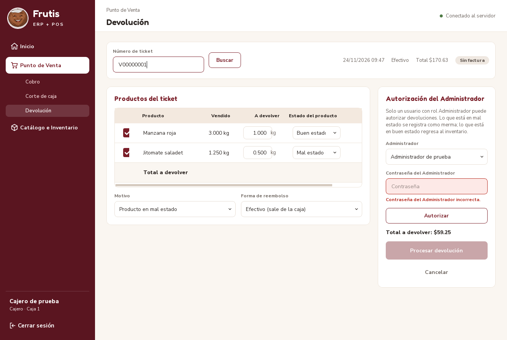
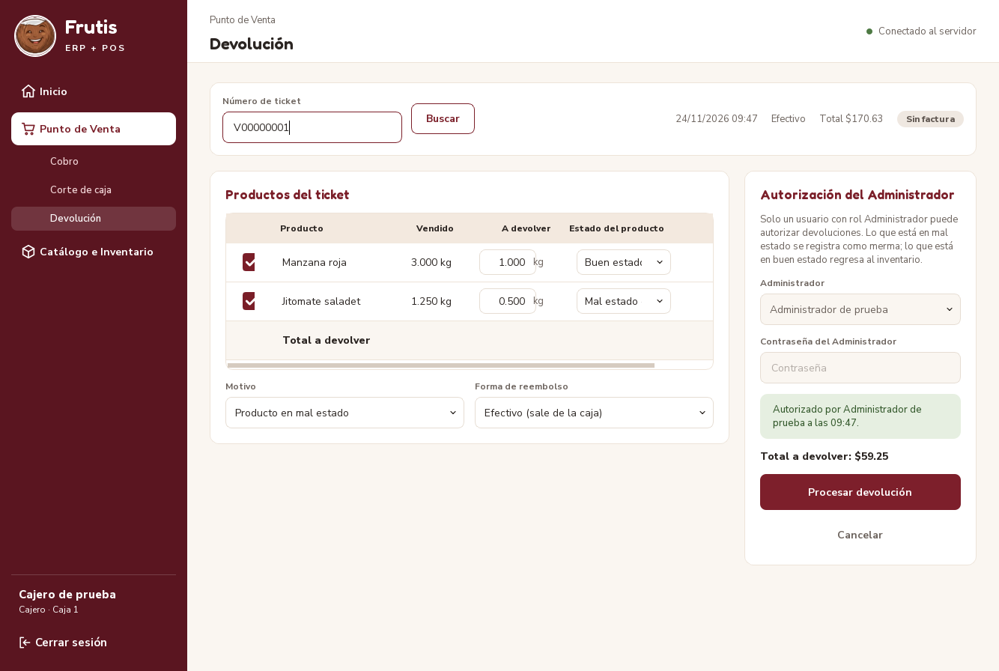
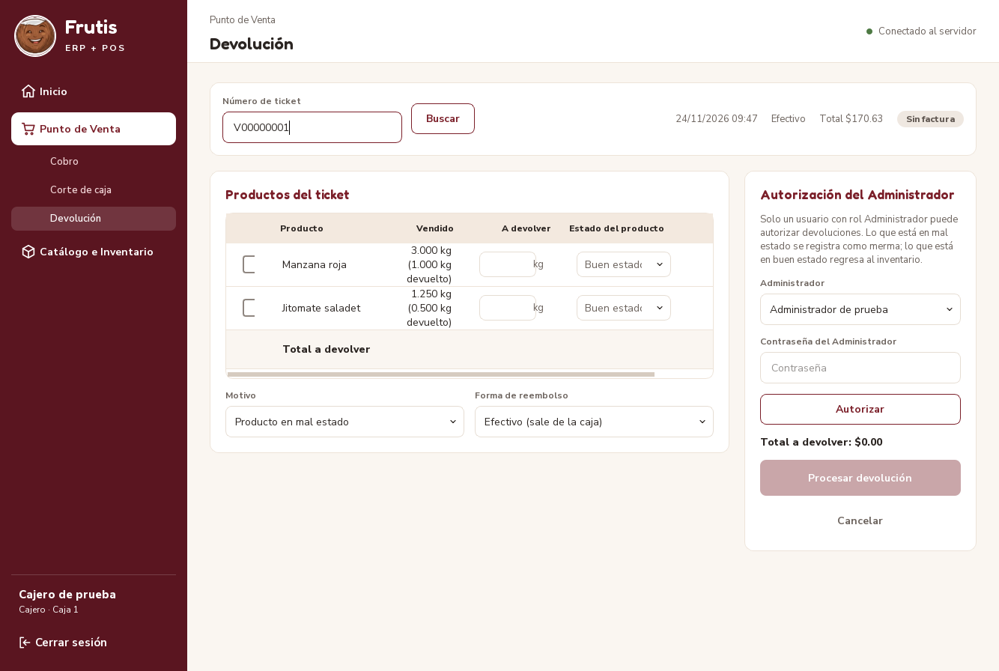
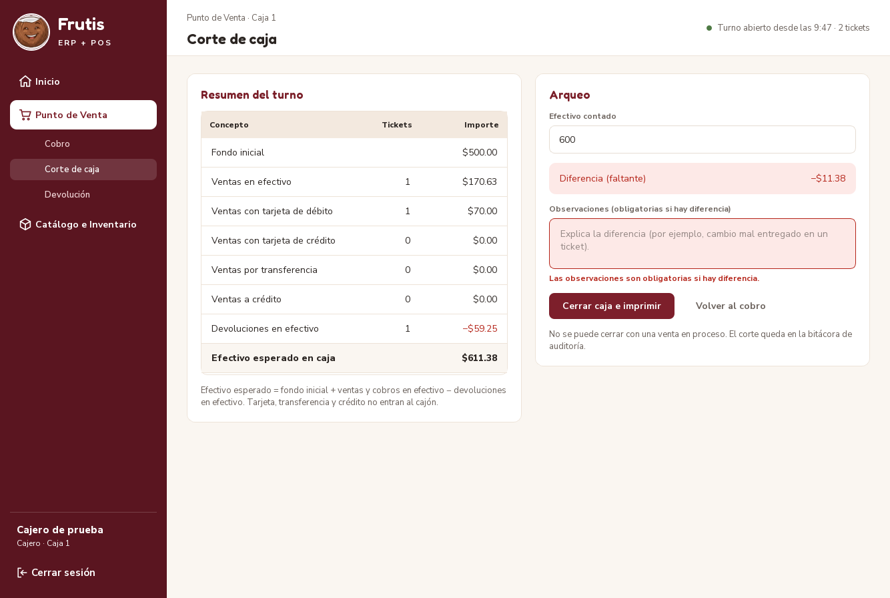
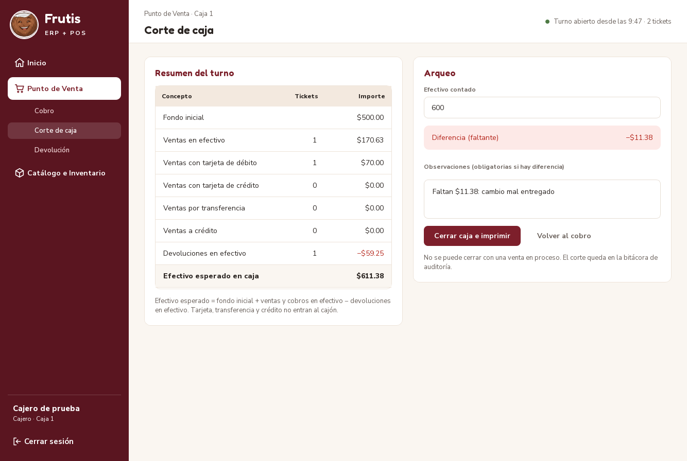
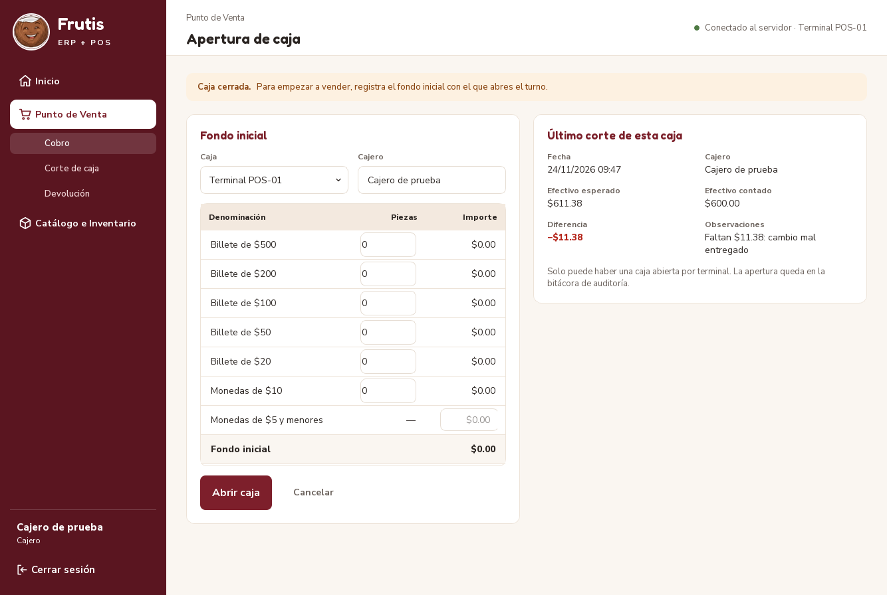
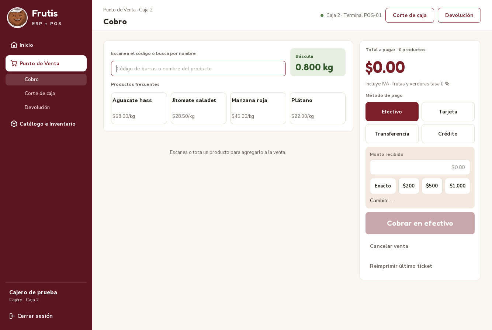

# Evidencia · Apertura, corte de caja y devoluciones

| Dato | Valor |
| --- | --- |
| Elementos de configuración | EC-08 Base de datos, EC-09 Middleware, EC-11 Frontend |
| Historias y solicitudes | HU-09 (corte de caja), HU-15 (apertura), HU-30 (devoluciones), SC-02 (#3) |
| Pull Request | #17, rama `feature/HU-09-corte-devoluciones` |
| Fecha | 24 de noviembre de 2026 |
| Equipo | Equipo de desarrollo con Windows 11 Pro. MySQL Community Server 8.0.46 desechable en el puerto 3399, middleware con uvicorn en `127.0.0.1:8499` y la aplicación de escritorio PySide6 |
| Versión del repositorio | `df948b4` más la corrección de la sección 7 |
| Resultado | **98 de 98 pruebas de base de datos, 89 de 89 del middleware, 42 de 42 del frontend, 26 de 26 verificaciones de la API y el recorrido completo en la aplicación** |

La base se instaló desde cero con `database/instalar.sh`. Antes de cada recorrido se volvió a instalar con `seed.sql`. Los usuarios y contraseñas son los de prueba de `seed.sql`; no aparecen datos reales.

## 1. Resumen

| Verificación | Esperado | Obtenido |
| --- | --- | --- |
| Pruebas de `tests/test_cobro.sql` (las de antes) | 50 OK | 50 OK |
| Pruebas nuevas de `tests/test_corte_devolucion.sql` | 48 OK | 48 OK |
| Migración `002_devoluciones_reembolso.sql` sobre una base con el esquema anterior | Las devoluciones existentes quedan como `efectivo` y la columna sin valor por omisión | Correcto |
| Pruebas del middleware (`pytest`) | 89 pasan | 89 pasan |
| Pruebas del frontend (`pytest`) | 42 pasan | 42 pasan |
| Rutas del middleware contra MySQL real | 26 respuestas con el código esperado | 26 de 26 |
| Recorrido en la aplicación: devolución → corte → apertura → cobro | Efectivo esperado $611.38 | $611.38 |

## 2. Recorrido en la aplicación de escritorio

La aplicación corrió en modo normal (no demostración) contra el middleware y MySQL. La terminal era `FRUTIS_TERMINAL=POS-01` y la sesión, la del cajero `cajero1`. La caja 1 estaba abierta con un fondo de $500.00.

Antes de las capturas se registraron dos ventas desde la misma sesión:

| Ticket | Método | Productos | Total |
| --- | --- | --- | --- |
| V00000001 | Efectivo (recibido $200.00, cambio $29.37) | 3 kg de manzana roja + 1.250 kg de jitomate | $170.63 |
| V00000002 | Tarjeta de débito | 2 piñas | $70.00 |

### 2.1 Devolución con contraseña incorrecta del Administrador



Se marcaron 1 kg de manzana en buen estado y 0.5 kg de jitomate en mal estado. Con una contraseña incorrecta, el campo muestra "Contraseña del Administrador incorrecta." y **Procesar devolución sigue deshabilitado**.

La sesión del cajero no se cierra: el middleware responde 403, no 401.

### 2.2 Devolución autorizada



Con la contraseña correcta aparece "Autorizado por Administrador de prueba" y se habilita el botón. El total a devolver ($59.25) se muestra junto al botón: 1 kg × $45.00 + 0.5 kg × $28.50.

Diálogos que mostró la aplicación al procesar:

```text
«Procesar devolución»: Se devolverán $59.25 con efectivo (sale de la caja).
«Devolución registrada»: Se devolvieron $59.25. Lo que estaba en mal estado se registró como merma.
```

### 2.3 El ticket muestra lo ya devuelto



Al buscar otra vez el ticket V00000001, cada producto indica cuánto ya se devolvió. La autorización anterior ya no sirve: se pide de nuevo.

### 2.4 Corte sin observaciones



El resumen del turno viene de `GET /pos/cortes/actual`.

Efectivo esperado = fondo $500.00 + ventas en efectivo $170.63 − devoluciones en efectivo $59.25 = **$611.38**. Tarjeta, transferencia y crédito aparecen en el resumen, pero no suman al cajón.

Con $600.00 contados, la diferencia es −$11.38 y el corte se rechaza: "Las observaciones son obligatorias si hay diferencia."

### 2.5 Corte con observaciones



```text
«Cerrar caja»: Se cerrará Caja 1 con $600.00 contados. Después no se podrá vender hasta abrir otro turno.
«Caja cerrada»: Corte registrado. Diferencia: −$11.38.
El comprobante se envió a la impresora (simulador).
```

### 2.6 Apertura con el último corte



Después del corte la aplicación lleva a la apertura. La tarjeta "Último corte de esta caja" muestra el corte recién guardado, leído de `GET /pos/cortes/ultimo?terminal=POS-01`.

### 2.7 Fondo inicial por denominación


1 billete de $200 + 1 de $100 + $50 en monedas = $350.00.

### 2.8 Cobro en el turno nuevo



Se abre la caja 2 en la misma terminal y la aplicación pasa al cobro.

### 2.9 Lo que quedó en la base

```text
+---------+----------+---------------+---------+-------------------+------------------+------------+-------------------------------------+
| id_caja | terminal | fondo_inicial | estatus | efectivo_esperado | efectivo_contado | diferencia | observaciones                       |
+---------+----------+---------------+---------+-------------------+------------------+------------+-------------------------------------+
|       1 | POS-01   |        500.00 | cerrada |            611.38 |           600.00 |     -11.38 | Faltan $11.38: cambio mal entregado |
|       2 | POS-01   |        350.00 | abierta |              NULL |             NULL |       NULL | NULL                                |
+---------+----------+---------------+---------+-------------------+------------------+------------+-------------------------------------+
+-------------+----------+---------+-----------------+-----------+-------------+
| folio       | cantidad | importe | estado_producto | reembolso | id_autoriza |
+-------------+----------+---------+-----------------+-----------+-------------+
| D00000001-1 |    1.000 |   45.00 | bueno           | efectivo  |           1 |
| D00000001-1 |    0.500 |   14.25 | danado          | efectivo  |           1 |
+-------------+----------+---------+-----------------+-----------+-------------+
+---------------+----------+------------+-------------+-------------------------------------------------+
| id_inventario | cantidad | motivo     | costo_total | observaciones                                   |
+---------------+----------+------------+-------------+-------------------------------------------------+
|             6 |    0.500 | devolucion |        9.00 | Devolución D00000001-1: Producto en mal estado  |
+---------------+----------+------------+-------------+-------------------------------------------------+
```

- La devolución la autorizó el usuario 1, el Administrador.
- El jitomate dañado quedó como merma del lote 6, al costo de compra (0.5 × $18.00).

## 3. Rutas del middleware contra MySQL

Las rutas se probaron con `TestClient` contra el middleware sin simulaciones, conectado a la base de prueba con `seed.sql`. Cada renglón indica si el código de respuesta fue el esperado. El token de autorización se recortó.

```text
OK  200 caja actual: {"id_caja": 1, "terminal": "POS-01", "fondo_inicial": "500.00", ...}
OK  409 segunda caja del mismo cajero: {"detail": "Ya tiene una caja abierta en la terminal POS-01."}
OK  201 venta efectivo: {"id_venta": 1, "folio": "V00000001", "total": "135.00", "cambio": "65.00"}
OK  201 venta tarjeta: {"id_venta": 2, "folio": "V00000002", "total": "70.00", "cambio": "0.00"}
OK  200 ticket: {"id_venta": 1, "folio": "V00000001", "metodo": "Efectivo", "estatus": "pagada", ...}
OK  404 ticket inexistente: {"detail": "No existe un ticket con ese número."}
OK  422 folio con inyección: {"detail": "Datos inválidos.", "errores": [{"campo": "path.folio", ...}]}
OK  200 administradores: [{"usuario": "admin", "nombre_completo": "Administrador de prueba"}]
OK  403 autorización mala: {"detail": "Contraseña del Administrador incorrecta."}
OK  403 autorización de un no admin: {"detail": "Solo un Administrador puede autorizar devoluciones."}
OK  200 autorización buena: {"autorizacion": "eyJhbGciOi…", "autorizado_por": "Administrador de prueba", "expira_minutos": 5}
OK  403 autorización usada en otro ticket: {"detail": "La autorización del Administrador no es válida o ya venció. Pida que autorice de nuevo."}
OK  409 devolución de más: {"detail": "La cantidad a devolver de Manzana roja no es válida."}
OK  201 devolución: {"folio": "D00000001-1", "total": "67.50", "reembolso": "efectivo"}
OK  200 ticket tras devolver: {"id_venta": 1, "folio": "V00000001", "estatus": "devuelta_parcial", ...}
OK  200 resumen del corte: {"id_caja": 1, "fondo_inicial": "500.00", "ventas": [...], "efectivo_esperado": "567.50"}
OK  409 corte con diferencia sin observaciones: {"detail": "Escriba las observaciones: hay diferencia en el arqueo."}
OK  422 observaciones con comillas: {"detail": "Datos inválidos.", "errores": [{"campo": "body.observaciones", ...}]}
OK  403 corte de caja ajena: {"detail": "La caja no pertenece al usuario."}
OK  201 corte: {"id_caja": 1, "efectivo_esperado": "567.50", "efectivo_contado": "500.00", "diferencia": "-67.50"}
OK  200 último corte: {"id_caja": 1, "terminal": "POS-01", "cajero": "Cajero de prueba", ...}
OK  404 caja actual tras el corte: {"detail": "No hay una caja abierta."}
OK  409 vender tras el corte: {"detail": "No hay una caja abierta."}
OK  201 abrir otra vez: {"id_caja": 2, "terminal": "POS-01", "fondo_inicial": "300.00", ...}
OK  409 terminal ocupada: {"detail": "Ya hay una caja abierta en esta terminal."}
OK  403 contador no abre caja: {"detail": "No tiene permiso para esta acción."}
```

### Bitácora de auditoría que dejó esta prueba (módulo `pos`)

Se registran también los intentos rechazados. La autorización queda a nombre del Administrador y la devolución, a nombre del cajero.

```text
+----------+---------+------------------------+--------------------------------------------------------------------------------------------------+
| hora     | usuario | accion                 | detalle                                                                                          |
+----------+---------+------------------------+--------------------------------------------------------------------------------------------------+
| 09:46:15 | cajero1 | apertura_rechazada     | Ya tiene una caja abierta en la terminal POS-01.                                                 |
| 09:46:15 | cajero1 | venta                  | Folio V00000001, total 135.00                                                                    |
| 09:46:15 | cajero1 | venta                  | Folio V00000002, total 70.00                                                                     |
| 09:46:15 | cajero1 | autorizacion_rechazada | Contraseña incorrecta. Ticket V00000001, solicitó cajero1, usuario admin                         |
| 09:46:15 | cajero1 | autorizacion_rechazada | El usuario no es un Administrador activo. Ticket V00000001, solicitó cajero1, usuario contador1  |
| 09:46:15 | admin   | autorizacion           | admin autorizó una devolución del ticket V00000001 a cajero1                                     |
| 09:46:15 | cajero1 | devolucion_rechazada   | La cantidad a devolver de Manzana roja no es válida.                                             |
| 09:46:15 | cajero1 | devolucion             | Folio D00000001-1 del ticket V00000001, total 67.50, reembolso efectivo, autorizó admin          |
| 09:46:15 | cajero1 | corte_rechazado        | Escriba las observaciones: hay diferencia en el arqueo.                                          |
| 09:46:16 | cajero1 | corte                  | Caja 1, esperado 567.50, contado 500.00, diferencia -67.50                                       |
| 09:46:16 | cajero1 | venta_rechazada        | No hay una caja abierta.                                                                         |
| 09:46:16 | cajero1 | apertura               | Caja 2, terminal POS-01, fondo 300.00                                                            |
| 09:46:16 | admin   | apertura_rechazada     | Ya hay una caja abierta en esta terminal.                                                        |
+----------+---------+------------------------+--------------------------------------------------------------------------------------------------+
```

## 4. Pruebas de la base de datos

Comando, sobre un servidor sin la base `frutis`:

```bash
MYSQL_ARGS="-h 127.0.0.1 -P 3399 -u root" ./database/instalar.sh --con-pruebas
```

El instalador terminó con código de salida 0. Las 50 pruebas de `tests/test_cobro.sql` pasaron igual que en la [evidencia del 4 de noviembre](evidencia_db_rocky_2026-11-04.md). Esta es la salida del archivo nuevo:

```text
>> tests/test_corte_devolucion.sql
OK   No abre una segunda caja en una terminal ocupada
OK   Un cajero no tiene dos turnos abiertos
OK   Rechaza fondo inicial negativo
OK   Rechaza terminal vacía
OK   Rechaza usuario inexistente
OK   Abre la caja con cajero, terminal, fondo y fecha de apertura
OK   La venta de jitomate usa 2 lotes
OK   Efectivo esperado = 500 fondo + 153.50 ventas en efectivo + 10 cobro; tarjeta y crédito no cuentan
OK   SC-02: un cajero no autoriza su devolución
OK   Rollback: la devolución rechazada por el trigger no regresa inventario
OK   Rechaza ticket inexistente
OK   No devuelve más de lo vendido
OK   Suma los renglones repetidos del mismo producto
OK   Rechaza un producto que no está en el ticket
OK   Las piezas se devuelven enteras
OK   Rechaza un estado del producto desconocido
OK   Rechaza una devolución sin productos
OK   Exige el motivo
OK   Rechaza una forma de reembolso desconocida
OK   Una venta de contado no se abona a crédito
OK   Solo se revierte a tarjeta un pago con tarjeta
OK   Una venta a crédito no se reembolsa en efectivo
OK   No devuelve desde una caja cerrada
OK   Ninguna devolución fallida deja inventario, mermas o devoluciones a medias
OK   La devolución recibe el folio D<venta>-1
OK   Devuelve 2.5 kg de jitomate a 28.50 = 71.25
OK   Una fila por lote: 1 kg del lote 6, 1 kg y 0.5 kg del lote 8
OK   Lo que está en buen estado regresa a sus lotes
OK   Lo que está en mal estado se registra como merma al costo del lote (0.5 x 18.00)
OK   El ticket queda como devuelto en parte
OK   El reembolso en efectivo se resta del esperado (663.50 - 71.25)
OK   La segunda devolución del ticket es la -2 y devuelve 14.25
OK   La devolución total suma exactamente el total del ticket
OK   El ticket queda como devuelto
OK   Un ticket devuelto no se devuelve otra vez
OK   El reverso a tarjeta no cambia el efectivo esperado
OK   El abono no puede pasar del saldo
OK   La devolución a crédito baja el saldo del cliente de 12.00 a 1.00
OK   No reembolsa más efectivo del que hay en la caja
OK   Un cajero no cierra la caja de otro
OK   Exige el efectivo contado
OK   Exige observaciones si hay diferencia
OK   El corte rechazado deja la caja abierta
OK   Arqueo: esperado 578.00, contado 570.00, diferencia -8.00
OK   El corte guarda esperado, contado, diferencia y observaciones
OK   No se vende en una caja cortada
OK   Una caja no se corta dos veces
OK   Se reabre la terminal tras el corte y un arqueo exacto cierra sin observaciones
Todas las pruebas de corte y devoluciones pasaron
Base de datos instalada.
```

### Migración en una base ya instalada

Se instaló el esquema de `develop` anterior a este cambio (`6231fa1`), con una devolución ya registrada, y después se corrió la migración:

```text
$ mysql < database/migraciones/002_devoluciones_reembolso.sql
código de salida: 0
+-------+-----------+
| folio | reembolso |
+-------+-----------+
| D-1   | efectivo  |
+-------+-----------+
+-------------+------------------------------------------------------+-------------+----------------+
| COLUMN_NAME | COLUMN_TYPE                                          | IS_NULLABLE | COLUMN_DEFAULT |
+-------------+------------------------------------------------------+-------------+----------------+
| reembolso   | enum('efectivo','tarjeta','transferencia','credito') | NO          | NULL           |
+-------------+------------------------------------------------------+-------------+----------------+
```

## 5. Pruebas del middleware

Se corrieron con `python -m pytest -v` en `middleware/`, sin MySQL: la conexión y los repositorios se sustituyen.

```text
============================= 89 passed in 3.14s ==============================
```

Las 45 nuevas están en `tests/test_caja_devoluciones.py`:

| Tema | Qué comprueban |
| --- | --- |
| Apertura | El cajero sale del token. Rechaza fondo negativo, terminal con inyección e `id_usuario` en el cuerpo. Conserva el mensaje de la base y no filtra errores internos |
| Corte | Resumen sin caja da 404. Caja ajena da 403. Rechaza `<script>`, `'; DROP TABLE` y comillas en las observaciones. Observaciones en blanco se mandan como NULL |
| Ticket | Folio inexistente da 404. Folios con inyección dan 422 |
| Autorización | Contraseña incorrecta da 403 (no 401) y cuenta para el bloqueo. Un usuario no Administrador, inactivo o bloqueado no autoriza. La autorización no sirve como sesión |
| Devolución | Usa al Administrador de la autorización. Rechaza autorizaciones de otro ticket, de otro cajero, vencidas o un token de sesión. Valida estado, reembolso, cantidades y caja propia |

## 6. Pruebas del frontend

Se corrieron con `python -m pytest -v` en `frontend/`, sin monitor (offscreen) y sin servidor.

```text
============================= 42 passed in 9.50s ==============================
```

Las 10 nuevas están en `tests/test_api_caja_devoluciones.py` y usan un middleware simulado. Verifican:
- que el cuerpo de cada petición respeta lo que espera el middleware;
- que el resumen del corte se arma con las filas de la pantalla;
- que la autorización vale por ticket y se usa una sola vez;
- que una contraseña incorrecta del Administrador no cierra la sesión del cajero.

## 7. Hallazgo corregido durante esta evidencia

En la primera toma de la captura 2.2, después de autorizar con la contraseña correcta, seguía visible en rojo el error del intento anterior ("Contraseña del Administrador incorrecta."). Esto confundía al cajero.

Se corrigió en `frontend/app/views/pos/devolucion.py`: el error del campo se borra cuando la autorización tiene éxito. Las capturas de este documento ya incluyen la corrección. Las 42 pruebas del frontend se repitieron después del cambio.

## 8. Alcance y limitaciones

- La prueba corrió en una instancia de MySQL desechable con el usuario `root`, no con `frutis_app`. Los procedimientos y la función nuevos solo necesitan el permiso `EXECUTE` que `frutis_app` ya tiene. Falta confirmarlo en el servidor de Rocky Linux.
- Los diálogos de confirmación se aceptaron de forma automática; su texto se transcribe en lugar de capturarse.
- La báscula y la impresora siguen con simulador (R-01, R-02).
- Quedan abiertas las decisiones anotadas en el PR #17:
  - devolución de una venta a crédito ya pagada;
  - plazo de devolución;
  - nota de crédito CFDI para tickets facturados;
  - cierre de una caja abandonada por el Administrador.
